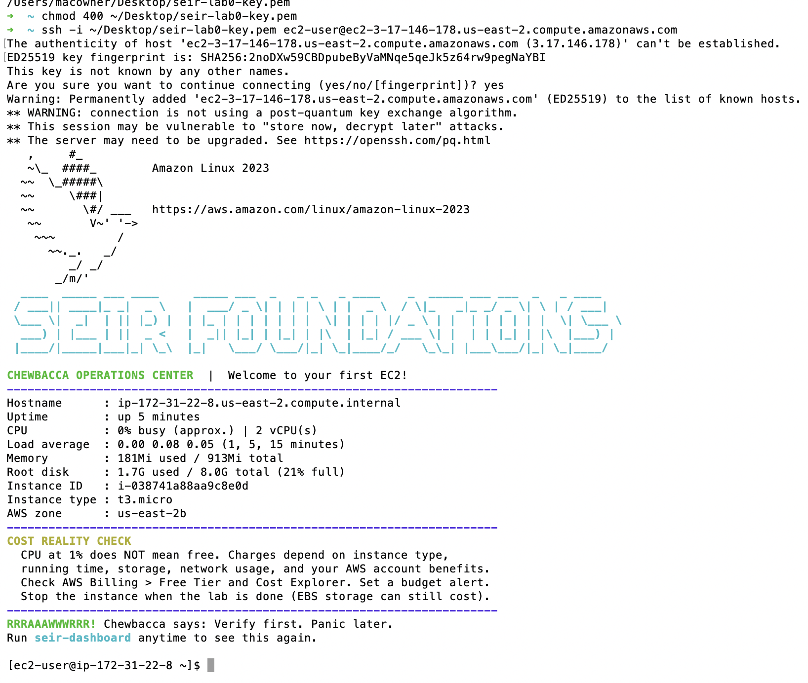
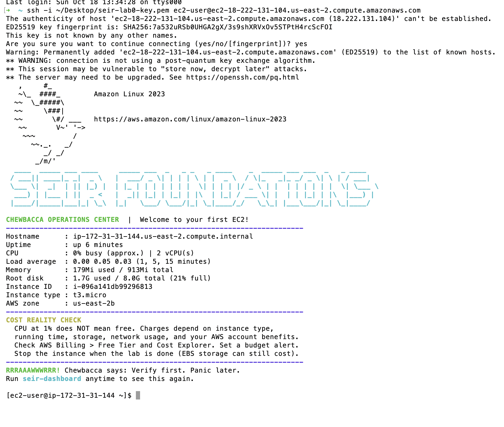
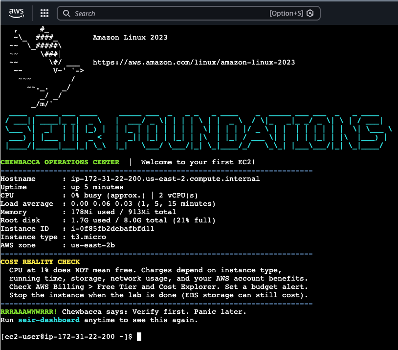

# Module 1 / Lab 0 — EC2 Basics

Three separate EC2 deployments from one saved launch template (`seir-lab0`), each connected to and terminated afterward. Region: US East (Ohio), us-east-2.

## Background

During class I was in and out because of work, so I followed the repo instructions on my own later. A classmate also helped me launch an instance a couple of days ago, but I did not have proper screenshots from that. That earlier instance is **not** one of the three deployments below. On 10/18/26 I started from scratch and realized I was supposed to create a launch template first, which was very helpful. All three deployments below were launched that day.

## Evidence table

| Deployment | Instance ID | Public IPv4 address | Connection method | Screenshot | Instance terminated? |
| :---- | :---- | :---- | :---- | :---- | :---- |
| 1 | i-038741a88aa9c8e0d | 3.17.146.178 | SSH from Mac Terminal | screenshots/deployment-1.png | Yes |
| 2 | i-096a141db99296813 | 18.222.131.104 | SSH from Mac Terminal | screenshots/deployment-2.png | Yes |
| 3 | i-0f85fb2debafbfd11 | 3.145.145.194 | EC2 Instance Connect (browser) | screenshots/deployment-3.png | Yes |

&nbsp;

All three public IPv4 addresses are different. No Elastic IP was used.

Supporting screenshots: `deployment-1-console.png`, `deployment-2-console.png`, `deployment-3-console.png` (Console view of instance ID and public IP), `all-instances-terminated.png`, `security-group-rules.png`.

## Setup

- Launch template: `seir-lab0` (`lt-00ade74b909937d57`), Amazon Linux 2023, t3.micro, key pair `seir-lab0-key`, security group `seir-lab0-sg`, full `seir_ec2_userdata.sh` pasted into User data.  
- Security group `seir-lab0-sg`: see "Security group changes" below.

## Deployment 1

I went to Launch Templates, chose Actions, then Launch instance from template, using `seir-lab0`. I waited for the 3/3 status checks to pass, then connected over SSH from my Mac Terminal as `ec2-user` using my key pair. The dashboard appeared, and I took screenshots of the Console and of the Terminal showing the SEIR Foundations dashboard. The dashboard showed: up 5 minutes, 2 vCPUs, 0% busy, load average 0.00 / 0.08 / 0.05, memory 181Mi of 913Mi, root disk 1.7G of 8.0G (21% full), us-east-2b.

## Deployment 2

I did the same process using the launch template. Before launching I checked that nothing had changed in the settings. I connected over SSH from my Mac Terminal again. I saw a different public IPv4 address, and the private IP was different too (172.31.31.144 versus 172.31.22.8 for deployment 1), because each launch creates a brand-new instance. The dashboard showed: up 6 minutes, 2 vCPUs, 0% busy, load average 0.00 / 0.05 / 0.03, memory 179Mi of 913Mi, root disk 1.7G of 8.0G (21% full), us-east-2b.

## Deployment 3

I followed the same launch-from-template process. This time I connected with the EC2 Connect button, the other option in the instructions. It showed the same dashboard in the AWS browser terminal, in dark mode. The public IPv4 was different again, and so was the private IP (172.31.22.200). The dashboard showed: up 5 minutes, 2 vCPUs, 0% busy, load average 0.00 / 0.06 / 0.03, memory 178Mi of 913Mi, root disk 1.7G of 8.0G (21% full), us-east-2b.

## What the dashboard metrics tell me

- **CPU / load average:** near 0% and 0.00 load means the instance was idle. Nothing was running except the OS and the web server.  
- **Memory:** about 180Mi of 913Mi in use (roughly 20%), so plenty of free RAM.  
- **Disk:** 1.7G of 8.0G used (21%) on the root volume.  
- **Uptime:** 5–6 minutes in each case, which matches how recently the instance booted and ran User data.

## One thing that got easier

After I had the launch template and understood how it works, the process got much easier. Terminating the instance also got easier, which matters because an instance left running can keep costing money. Terminating (not just stopping) also removes the root volume, so nothing is left billing.

## Errors and fixes

- The key file was saved to my Desktop, not Downloads, so `chmod` and `ssh` failed with "No such file or directory." I found it with `mdfind -name seir-lab0` and used the Desktop path.  
- I pasted the `chmod` and `ssh` commands on one line. They need to be run as two separate commands.  
- My first security group choice was an existing group (`MyTestGroup_SG`) with SSH and HTTP open to the whole internet. I created a new group, `seir-lab0-sg`, instead.

## Security group changes

- `seir-lab0-sg` started with a single SSH (TCP 22\) rule from My IP.  
- Before launching deployment 1, I changed the SSH source to Anywhere-IPv4 (0.0.0.0/0) and added an HTTP (TCP 80\) rule with source Anywhere-IPv4. These changes were based on my class notes and my professor's verbal instructions about the SSH and HTTP ports. The repo instructions did not mention them.  
- All three deployments ran with the same two rules (SSH 22 and HTTP 80, both from Anywhere-IPv4). This is also why the browser Connect button worked for deployment 3\.  
- These rules are for short-lived lab instances protected by a key pair. All instances are terminated.

## Cleanup confirmation

- All three instances show Terminated.  
- EC2 Volumes: empty. Elastic IPs: empty.  
- The launch template `seir-lab0` was kept for later labs.